# Demo: three real apps, end to end

!!! abstract "At a glance"
    - **Three free apps people already know:** VLC media player, PuTTY and Microsoft XML Notepad.
    - **Two lanes in one demo.** Convert an installer to MSIX (VLC and PuTTY), or use an MSIX package its publisher has already signed (XML Notepad).
    - **One script gets everything** and checks every file against the publisher's hash and signature.
    - **The same signed packages** go to Azure Virtual Desktop with App Attach, and to Windows 365 with Intune.
    - **About an hour to build the first time**, and 45 minutes to demo.

## The three apps

<span class="level l100">Level 100</span>

| App | What it shows | Starts as | Route | Signing |
| --- | --- | --- | --- | --- |
| **Microsoft XML Notepad** | The fast lane: nothing to convert or sign. Learn suggests it as a test package ([Create an MSIX image](https://learn.microsoft.com/azure/virtual-desktop/app-attach-create-msix-image)) | MSIX bundle | Straight to an image | Already signed with a publicly trusted certificate |
| **VLC media player** | Converting a real installer, step by step in the MSIX Packaging Tool | MSI, signed by VideoLAN | Interactive conversion | You sign it |
| **PuTTY** | Converting from the command line, which is how you'd do sixty | MSI, signed by Simon Tatham | Command line template | You sign it |

```mermaid
flowchart TB
    K["Get-AppAttachDemoKit.ps1<br/>downloads and checks"] --> X["XML Notepad<br/>already MSIX"]
    K --> V["VLC<br/>MSI"]
    K --> P["PuTTY<br/>MSI"]
    V --> C["MSIX Packaging Tool<br/>convert and sign"]
    P --> C
    X --> I["MSIXMGR<br/>CimFS image"]
    C --> I
    C --> W["Windows 365<br/>Intune line-of-business app"]
    X --> W
    I --> S["Azure Files share"]
    S --> A["Azure Virtual Desktop<br/>App Attach"]
```



All three are free for organisations to use. App-V packages are a third lane. App Attach takes them as they are, with no conversion and no signing, so add one of your own in step 9 if you have them ([From App-V to App Attach and MSIX](from-app-v.md)).

## What you need first

<span class="level l200">Level 200</span>

- [ ] **A clean packaging VM** running Windows 11 Enterprise, the same version as the session hosts or older. Learn says CIM images must be created on a Windows version lower than or equal to the one that runs them ([Create an MSIX image](https://learn.microsoft.com/azure/virtual-desktop/app-attach-create-msix-image)). You'll need local admin, and a snapshot to roll back to after each conversion ([Prepare your environment](https://learn.microsoft.com/windows/msix/packaging-tool/prepare-your-environment)).
- [ ] **Internet access from that VM** to the places the kit downloads from. If your proxy blocks them, someone can put the files on a share instead.

    | Host | For |
    | --- | --- |
    | `download.microsoft.com` | The MSIX Packaging Tool, its licence and its driver |
    | `aka.ms`, `github.com`, `api.github.com`, `release-assets.githubusercontent.com` | MSIXMGR and XML Notepad, both published on GitHub |
    | `codeload.github.com` | This toolkit, if you download it as a zip |
    | `download.videolan.org` | VLC media player |
    | `the.earth.li` | PuTTY |

- [ ] **A code signing certificate.** Its **Subject** must exactly match the package **Publisher** ([Create a certificate for package signing](https://learn.microsoft.com/windows/msix/package/create-certificate-package-signing)). Get the exact Subject string before you convert anything. See [Signing certificates, demystified](certificates.md).
- [ ] **Trust for that certificate** on the session hosts and Cloud PCs. Hybrid joined hosts trust an AD CS enterprise CA automatically. Microsoft Entra joined hosts and Cloud PCs get the root through an Intune trusted certificate profile ([Trusted root certificate profiles](https://learn.microsoft.com/intune/device-configuration/certificates/trusted-root-profiles)).
- [ ] **A file share** on Azure Files, in the same region as the session hosts. For Microsoft Entra joined hosts, the storage account must be in the same subscription as the session hosts, and the **Azure Virtual Desktop** and **Azure Virtual Desktop ARM Provider** service principals need the **Reader and Data Access** role on it ([Add and manage App Attach applications](https://learn.microsoft.com/azure/virtual-desktop/app-attach-setup)). Use a storage account just for App Attach ([Requirements and file shares](requirements.md)). If public network access is turned off, add a private endpoint and its DNS record.
- [ ] **A host pool** with at least one session host powered on, because Learn says you need one when you add an application ([Add and manage App Attach applications](https://learn.microsoft.com/azure/virtual-desktop/app-attach-setup)).
- [ ] **Permissions:** at least **Desktop Virtualization Contributor** on the resource group to add packages, plus `Microsoft.Authorization/roleAssignments/write` on the application group to assign users. Owner and User Access Administrator include it ([Add and manage App Attach applications](https://learn.microsoft.com/azure/virtual-desktop/app-attach-setup)).
- [ ] **A test user group**, and for Windows 365, a group of test Cloud PC users and the Intune rights to add an app.

## 1. Get the kit

<span class="level l200">Level 200</span>

On the packaging VM, in PowerShell:

```powershell
Set-ExecutionPolicy -Scope Process -ExecutionPolicy Bypass
Invoke-WebRequest https://github.com/marckean/AVD-Reference_Architecture/archive/refs/heads/main.zip -OutFile C:\toolkit.zip -UseBasicParsing
Expand-Archive C:\toolkit.zip C:\Toolkit
Get-ChildItem C:\Toolkit -Recurse | Unblock-File
cd C:\Toolkit\AVD-Reference_Architecture-main\tools\app-attach\demo
.\Get-AppAttachDemoKit.ps1 -PublisherName 'CN=<your certificate Subject>'
```

`Unblock-File` lets the scripts run even where the execution policy is **RemoteSigned** ([Unblock-File](https://learn.microsoft.com/powershell/module/microsoft.powershell.utility/unblock-file)).

[Get-AppAttachDemoKit.ps1](https://github.com/marckean/AVD-Reference_Architecture/blob/main/tools/app-attach/demo/Get-AppAttachDemoKit.ps1) puts everything in `C:\AppAttachDemo`, checks each file, and installs nothing. This is a real run:

| Item | Version | Hash check | Signature | Signed by |
| --- | --- | --- | --- | --- |
| VLC | 3.0.24 | Match | Valid | VideoLAN |
| PuTTY | 0.85 | Match | Valid | Simon Tatham |
| XmlNotepad | 2.9.0.22 | Match | Valid | Chris Lovett |
| MsixPackagingTool | 1.2024.405.0 | NotPublished | ValidTimestamped | Microsoft Corporation |
| MsixPackagingToolDriver | Windows 11 | NotPublished | Valid | Microsoft Corporation |
| MsixMgr | Latest | NotPublished | NotSigned | |

- **Match** means the file's SHA256 equals the hash the publisher publishes. A mismatch deletes the file and stops the script.
- **ValidTimestamped** means the signing certificate has since expired, but the signature carries a timestamp from while it was valid. Windows treats that as valid.
- **MSIXMGR** from Learn's download link isn't Authenticode signed, so the kit records its hash in `kit-manifest.csv`.

The script also writes `conversion-input.csv` for step 5, with your Publisher already filled in.

## 2. Install the tools

<span class="level l200">Level 200</span>

Open PowerShell **as administrator**, and keep that session for the rest of the build:

```powershell
Set-ExecutionPolicy -Scope Process -ExecutionPolicy Bypass
cd C:\Toolkit\AVD-Reference_Architecture-main\tools\app-attach\demo
.\Install-PackagingTools.ps1
```

[Install-PackagingTools.ps1](https://github.com/marckean/AVD-Reference_Architecture/blob/main/tools/app-attach/demo/Install-PackagingTools.ps1) follows Learn's offline steps ([Use the MSIX Packaging Tool in a disconnected environment](https://learn.microsoft.com/windows/msix/packaging-tool/disconnected-environment)):

- It provisions the MSIX Packaging Tool from its offline bundle and licence.
- It installs the MSIX Packaging Tool driver with DISM.
- It shows where MSIXMGR is.

Restart if it says to, then **take a snapshot**. That's your clean starting point for every conversion.

## 3. Sort out the certificate

<span class="level l200">Level 200</span>

=== "Your organisation's certificate"

    Ask for a code signing certificate from your CA, as a `.pfx` file, or have your signing team sign the packages for you. Either way, you need its exact Subject now, because every package's Publisher must match it.

=== "A test certificate for a quick lab"

    ```powershell
    .\New-TestSigningCertificate.ps1 -Subject 'CN=Contoso App Packaging, O=Contoso Ltd, C=AU' -OutputDirectory C:\AppAttachDemo\Certificate
    ```

    [New-TestSigningCertificate.ps1](https://github.com/marckean/AVD-Reference_Architecture/blob/main/tools/app-attach/demo/New-TestSigningCertificate.ps1) runs Learn's command and prompts for a password for the `.pfx`. It's for testing only. Learn says to install a self-signed root in the **Trusted Root Certification Authorities** store on each session host, and not to distribute it with Group Policy or Intune ([App Attach overview](https://learn.microsoft.com/azure/virtual-desktop/app-attach-overview)).

## 4. Convert VLC, step by step

<span class="level l200">Level 200</span>

These are the pages of the MSIX Packaging Tool, in order ([Create an MSIX package from any desktop installer](https://learn.microsoft.com/windows/msix/packaging-tool/create-app-package)):

| Page | What to do |
| --- | --- |
| **Welcome** | Select **Application package**, then **Create package on this computer**. |
| **Prepare computer** | The driver should show as installed. Let the tool turn off Windows Update while it captures. |
| **Select installer** | Browse to `C:\AppAttachDemo\Installers\vlc-3.0.24-win64.msi`. With an MSI, the tool fills in the package information for you. Under **Signing preference**, select **Sign with a certificate (.pfx)**, enter its password, and add a timestamp server URL. |
| **Package information** | Package name `VideoLAN.VLC`, display name `VLC media player`, publisher display name `VideoLAN`, version `3.0.24.0`. Check the **Publisher name** matches the certificate Subject exactly. |
| **Installation** | The tool runs the installer. Finish it, then select **Next**. |
| **Manage first launch tasks** | Keep **VLC media player** as the main entry point, and remove any extra entries, such as documentation or website links. Run VLC once to capture its first-run settings. |
| **Services report** | VLC has no services, so this is empty. |
| **Create package** | Save to `C:\AppAttachDemo\Packages`. |

Revert to the snapshot before the next conversion.

## 5. Convert PuTTY from the command line

<span class="level l300">Level 300</span>

This is how you'd convert sixty packages: one template each, run unattended. Make the templates from the kit's `conversion-input.csv`, then convert PuTTY in an elevated session:

```powershell
cd C:\Toolkit\AVD-Reference_Architecture-main\tools\app-attach
.\New-MsixConversionTemplate.ps1 -InstallerCsvPath C:\AppAttachDemo\conversion-input.csv -OutputDirectory C:\AppAttachDemo\Templates -PackageOutputDirectory C:\AppAttachDemo\Packages -PublisherName 'CN=<your certificate Subject>' -PublisherDisplayName 'Contoso'
MsixPackagingTool.exe create-package --template C:\AppAttachDemo\Templates\putty-64bit-0.85-installer.template.xml -v
```

- **No installer switches needed.** For MSI files, the tool adds the silent switches itself ([Generate a template file](https://learn.microsoft.com/windows/msix/packaging-tool/generate-template-file)).
- **Sign it afterwards.** A template's signing section only covers Device Guard signing, so the package comes out unsigned. Open it in the tool's **Package editor**, which Learn says to sign with before you save ([Package editor](https://learn.microsoft.com/windows/msix/packaging-tool/package-editor)). A pipeline would use SignTool instead ([Sign an app package using SignTool](https://learn.microsoft.com/windows/msix/package/sign-app-package-using-signtool)).

## 6. XML Notepad needs nothing

<span class="level l100">Level 100</span>

It's already an MSIX bundle, signed with a publicly trusted certificate, and Windows trusts most code signing CAs by default ([Sign an MSIX package](https://learn.microsoft.com/windows/msix/package/signing-package-overview)). Go straight to the image.

## 7. Make the App Attach images

<span class="level l200">Level 200</span>

In an elevated session:

```powershell
.\New-AppAttachImage.ps1 -PackagePath C:\AppAttachDemo\Packages\*.msix, C:\AppAttachDemo\Installers\*.msixbundle -OutputDirectory C:\AppAttachDemo\Images -MsixMgrPath C:\AppAttachDemo\Tools\msixmgr\x64\msixmgr.exe
```

[New-AppAttachImage.ps1](https://github.com/marckean/AVD-Reference_Architecture/blob/main/tools/app-attach/New-AppAttachImage.ps1) runs Learn's MSIXMGR command for each package and gives each CimFS image its own folder, as Learn recommends, because a CIM image is several files ([Create an MSIX image](https://learn.microsoft.com/azure/virtual-desktop/app-attach-create-msix-image)).

## 8. Copy the images to the share

<span class="level l200">Level 200</span>

Copy each image folder to the App Attach share, for example `\\<storage account>.file.core.windows.net\appattach\`. Then check the share's settings and permissions with [Test-AppAttachShare.ps1](https://github.com/marckean/AVD-Reference_Architecture/blob/main/tools/app-attach/Test-AppAttachShare.ps1).

## 9. Deliver to Azure Virtual Desktop

<span class="level l200">Level 200</span>

In the Azure portal ([Add and manage App Attach applications](https://learn.microsoft.com/azure/virtual-desktop/app-attach-setup)):

1. Go to **Azure Virtual Desktop**, select **App Attach**, then **+ Create**.
2. On **Basics**, select the subscription, resource group, host pool and location.
3. On **Image path**, select the storage account and file share, select the `.cim` file and the MSIX package in it, then choose the display name, **Registration type**, **State** and **Health check status on failure**.
4. On **Assignments**, select the host pool and your test user group.
5. Select **Review + create**.

Learn says that adding a package, setting it to active, and assigning it to a host pool and users makes the application available in a desktop session. To publish it as a RemoteApp instead, add it to a RemoteApp application group with **App Attach** as the source. Repeat for each app, or script it with [Add-AppAttachApplication.ps1](https://github.com/marckean/AVD-Reference_Architecture/blob/main/tools/app-attach/Add-AppAttachApplication.ps1).

Sign in as a test user. All three apps should be in the Start menu, and VLC should play a video.

## 10. Deliver the same packages to Windows 365

<span class="level l200">Level 200</span>

App Attach is an Azure Virtual Desktop feature. Windows 365 gets the same signed packages from Intune ([Deploy MSIX apps using the Intune admin center](https://learn.microsoft.com/windows/msix/desktop/managing-your-msix-deployment-mem-adminconsole)):

1. In the Intune admin center, go to **Apps**, **All apps**, **Add**.
2. Select **Line-of-business app**, then upload the signed `.msix` or `.msixbundle` file.
3. Check the details the tool fills in, set **App install context** to **Device**, then select **Next**.
4. Assign it as **Required** to your test Cloud PC group, then create it.

Learn's Intune guidance says that with a self-signed certificate, you must deploy a **Trusted certificate** profile to the devices first, or installation fails. A certificate from your own CA needs the same: Learn says a package has to chain to a root the device trusts ([Sign an MSIX package](https://learn.microsoft.com/windows/msix/package/signing-package-overview)), so push the root with the same kind of profile.

## The 45-minute demo

<span class="level l100">Level 100</span>

| Minutes | Show | The point |
| --- | --- | --- |
| 0 to 5 | The two lanes ([From App-V to App Attach and MSIX](from-app-v.md)) | Your App-V packages work today, and MSIX comes at your own pace |
| 5 to 15 | XML Notepad: image, App Attach, sign in | App Attach is a few clicks once the share is ready |
| 15 to 30 | VLC: convert, sign, image, deliver, play a video | Converting a real app takes minutes, not weeks |
| 30 to 35 | PuTTY from a template | The same steps, at scale |
| 35 to 40 | One of your App-V packages, as it is | No conversion, no signing |
| 40 to 45 | Windows 365: the same package through Intune | One package, two platforms |

## If something goes wrong

<span class="level l200">Level 200</span>

| Symptom | Likely cause | Fix |
| --- | --- | --- |
| Scripts won't run, even with `-Scope Process` | The **Turn on Script Execution** Group Policy setting, which overrides the execution policy in all scopes ([about_Execution_Policies](https://learn.microsoft.com/powershell/module/microsoft.powershell.core/about/about_execution_policies#use-group-policy-to-manage-execution-policy)) | Ask your desktop team for an exception on the packaging VM |
| The package won't sign or install | The Publisher doesn't match the certificate Subject | Edit the Publisher in the Package editor and sign again |
| The app won't install on a host | The certificate chain isn't trusted there | Push the root and intermediate certificates |
| You can't add the package | No session host is powered on | Start one, then try again |
| The image won't mount | The share or its permissions | Run `Test-AppAttachShare.ps1` |

More symptoms and fixes are on [Troubleshooting](troubleshooting.md).

## Microsoft Learn

- [Create an MSIX image to use with App Attach in Azure Virtual Desktop](https://learn.microsoft.com/azure/virtual-desktop/app-attach-create-msix-image)
- [Add and manage App Attach applications in Azure Virtual Desktop](https://learn.microsoft.com/azure/virtual-desktop/app-attach-setup)
- [Create an MSIX package from any desktop installer](https://learn.microsoft.com/windows/msix/packaging-tool/create-app-package)
- [Use the MSIX Packaging Tool in a disconnected environment](https://learn.microsoft.com/windows/msix/packaging-tool/disconnected-environment)
- [Generate a template file for command line conversions](https://learn.microsoft.com/windows/msix/packaging-tool/generate-template-file)
- [Edit a package using Package editor](https://learn.microsoft.com/windows/msix/packaging-tool/package-editor)
- [Create a certificate for package signing](https://learn.microsoft.com/windows/msix/package/create-certificate-package-signing)
- [Sign an app package using SignTool](https://learn.microsoft.com/windows/msix/package/sign-app-package-using-signtool)
- [Deploy MSIX apps using the Intune admin center](https://learn.microsoft.com/windows/msix/desktop/managing-your-msix-deployment-mem-adminconsole)
- [Trusted root certificate profiles for Microsoft Intune](https://learn.microsoft.com/intune/device-configuration/certificates/trusted-root-profiles)
