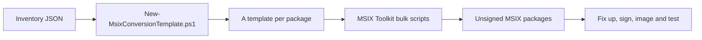

# From App-V to App Attach and MSIX

!!! abstract "At a glance"
    - **Your App-V packages work today.** App Attach delivers `.appv` files as they are: no App-V server, no repackaging and no signing.
    - **There's no cliff.** The App-V client follows the Windows lifecycle, and App-V server is supported until 9 October 2029. Microsoft's advice is still to plan the move.
    - **Convert at your own pace, easiest first.** One script rates every package Low, Medium or High, and says why.
    - **The MSIX Packaging Tool reads App-V 5.1 packages directly.** Most of the effort goes into fix-ups, signing and testing, not the conversion itself.
    - **Nobody waits.** The App-V package keeps working until its MSIX version is signed off.

## Two lanes, one destination

<span class="level l100">Level 100</span>

![From App-V to MSIX, one package at a time. Six numbered steps run the same way for every package: 1, inventory and rate, where one script reads every .appv file and rates its effort as Low, Medium or High; 2, make templates, one conversion template per package generated from the inventory; 3, convert, where the MSIX Packaging Tool reads App-V 5.1 packages directly on a clean machine; 4, fix up in the Package Editor with PSF fixups, context menus and the services report; 5, sign with a timestamp, then MSIXMGR makes the CimFS image; 6, test on a clean machine, then with a test group, and the owner signs off. Meanwhile, App Attach keeps delivering the original App-V package until its MSIX version is signed off, so users never wait for a conversion.](../assets/images/appv-conversion-line-light.svg#only-light)
![From App-V to MSIX, one package at a time. Six numbered steps run the same way for every package: 1, inventory and rate, where one script reads every .appv file and rates its effort as Low, Medium or High; 2, make templates, one conversion template per package generated from the inventory; 3, convert, where the MSIX Packaging Tool reads App-V 5.1 packages directly on a clean machine; 4, fix up in the Package Editor with PSF fixups, context menus and the services report; 5, sign with a timestamp, then MSIXMGR makes the CimFS image; 6, test on a clean machine, then with a test group, and the owner signs off. Meanwhile, App Attach keeps delivering the original App-V package until its MSIX version is signed off, so users never wait for a conversion.](../assets/images/appv-conversion-line-dark.svg#only-dark)

- **The bridge.** Add the `.appv` file to App Attach as it is, and users get the application now ([App Attach overview](https://learn.microsoft.com/azure/virtual-desktop/app-attach-overview)).
- **The destination.** Convert to MSIX when it suits you, one package at a time, with the same six steps every time.
- **The switch.** When the MSIX version is signed off, assign it instead of the App-V one, then retire the `.appv` file.

## Where App-V stands

<span class="level l100">Level 100</span>

| Part | What Microsoft says | What it means |
| --- | --- | --- |
| App-V client and sequencer | They *"follow the lifecycle of their corresponding Windows version. They aren't deprecated."* | They ship with Windows and get bug and security fixes, but no new features |
| App-V server | *"App-V server remains in fixed extended support through October 9, 2029."* | You don't need one for Azure Virtual Desktop: App Attach delivers the packages |
| The direction | *"Should I migrate away from App-V? Yes."* | MSIX is the modern Windows app package format |

All three quotes are from the [App-V in Windows support policy](https://learn.microsoft.com/microsoft-desktop-optimization-pack/app-v/appv-support-policy). The [App-V and MSIX comparison](https://learn.microsoft.com/windows/msix/comparisonofappvwithmsix) gives the same 2029 date.

## Rate your packages first

<span class="level l200">Level 200</span>

Run [Get-AppVPackageInventory.ps1](https://github.com/marckean/AVD-Reference_Architecture/blob/main/tools/app-attach/Get-AppVPackageInventory.ps1) against the folder or share that holds your packages. It opens each `.appv` file without the App-V client, reads its manifest and its dynamic configuration files, and rates how much work a conversion is likely to need.

```powershell
.\Get-AppVPackageInventory.ps1 -Path \\server\appv -Recurse -CsvPath .\appv-inventory.csv -JsonPath .\appv-inventory.json
```

| Rating | When | What it usually takes |
| --- | --- | --- |
| **Low** | Shortcuts, file type associations and URL protocols only | Convert, sign and test |
| **Medium** | COM, fonts or environment variables | A manifest check or a Package Support Framework (PSF) fixup |
| **High** | Dynamic configuration scripts, services, shell extensions, or sequenced before App-V 5.1 | A person rebuilds or redesigns part of it |

Each package also gets `ConversionNotes`, one line per finding, saying what to check. Put the Low ones in your first conversion wave.

!!! tip "A triage aid, not a verdict"
    The rating comes from what each package declares. Only a test tells you whether the converted package works.

### What raises the rating, and why

| The package has... | What happens in MSIX | Source |
| --- | --- | --- |
| Scripts in a dynamic configuration file | MSIX has no dynamic configuration file. The PSF can run one PowerShell script before the app starts and one after it closes, and needs the PowerShell execution policy set to `RemoteSigned` | [Run scripts with the PSF](https://learn.microsoft.com/windows/msix/psf/run-scripts-with-package-support-framework) |
| Services | The MSIX Packaging Tool shows a services report: included services, and excluded ones that need more information, need a fix or aren't supported. Packages with services need Windows 10 version 2004 or later | [Services](https://learn.microsoft.com/windows/msix/packaging-tool/convert-an-installer-with-services), [Known issues](https://learn.microsoft.com/windows/msix/packaging-tool/tool-known-issues) |
| Shell extensions | A context menu *"is not automatically added, so you will need to add it manually to the manifest"*. Windows 11 supports MSIX shell extensions in the classic context menu | [Known issues](https://learn.microsoft.com/windows/msix/packaging-tool/tool-known-issues), [MSIX on Windows 10 and 11](https://learn.microsoft.com/windows/apps/package-and-deploy/msix-windows10-windows11) |
| Sequenced before App-V 5.1 | *"The MSIX Packaging Tool currently supports App-V 5.1."* For older packages, convert from the source installer | [Create an MSIX package](https://learn.microsoft.com/windows/msix/packaging-tool/create-app-package) |
| COM | The MSIX manifest declares COM servers as package extensions | [Package extensions](https://learn.microsoft.com/windows/apps/desktop/modernize/desktop-to-uwp-extensions) |
| Fonts | Fonts are shared through a shared fonts extension | [Package extensions](https://learn.microsoft.com/windows/apps/desktop/modernize/desktop-to-uwp-extensions) |
| Environment variables | The Package Editor's **PSF Fixups** tab includes an environment variable fixup | [Automated PSF config generation](https://learn.microsoft.com/windows/msix/psf/psf-integration-with-mpt) |
| File type associations | *"The issues regarding File Type Associations (FTA) vary from package to package"*, so check each one | [Known issues](https://learn.microsoft.com/windows/msix/packaging-tool/tool-known-issues) |

App-V connection groups are defined outside the packages, so the script can't see them. List them separately, because they change how you convert (see the next section).

## What changes when App-V becomes MSIX

<span class="level l200">Level 200</span>

| | App-V | MSIX |
| --- | --- | --- |
| Apps that work together | Connection groups | Shared package containers, on Windows 11 |
| Updates | Download the complete app | Only the changes (delta updates) |
| The same file in several apps | Can be duplicated | One copy of any file |
| Signing | Not required | Required |

That table is from the [App-V and MSIX comparison](https://learn.microsoft.com/windows/msix/comparisonofappvwithmsix). Two more changes matter when you convert:

- **Customisation moves.** Whatever the dynamic configuration files did now lives in the manifest, a PSF fixup or a PSF script ([PSF overview](https://learn.microsoft.com/windows/msix/psf/package-support-framework-overview)).
- **Writes are redirected.** MSIX sends writes to protected locations into a per-user folder, and writes to `HKLM\Software` into a per-package hive, which is why some apps need the PSF ([MSIX troubleshooting guide](https://learn.microsoft.com/windows/msix/msix-troubleshooting-guide)).

## Convert one package, step by step

<span class="level l300">Level 300</span>

1. **Use a clean machine.** A virtual machine with the MSIX Packaging Tool and a checkpoint to go back to. Let the tool's **Prepare computer** step apply its fixes. Learn calls it *"optional but highly recommended"* ([Best practices](https://learn.microsoft.com/windows/msix/packaging-tool/tool-best-practices)).
2. **Choose Application package and pick the `.appv` file.** You're *"fast tracked to the create an MSIX page"*, because the package's manifest *"simply needs to get translated"* ([Create an MSIX package](https://learn.microsoft.com/windows/msix/packaging-tool/create-app-package)).
3. **Set the publisher to your certificate's subject, exactly.** A mismatch is the most common signing failure ([Troubleshooting](troubleshooting.md#signing)).
4. **Fix up in the Package Editor.** Check the manifest, add any context menus, review the services report, and use the **PSF Fixups** tab, which writes the PSF configuration for you ([Automated PSF config generation](https://learn.microsoft.com/windows/msix/psf/psf-integration-with-mpt)).
5. **Sign it, with a timestamp.** SHA-1 certificates aren't supported for MSIX, and a timestamp keeps the package installable after the certificate expires ([Best practices](https://learn.microsoft.com/windows/msix/packaging-tool/tool-best-practices)). See [Signing certificates, demystified](certificates.md).
6. **Make the CimFS image** with MSIXMGR ([Create an MSIX image](https://learn.microsoft.com/azure/virtual-desktop/app-attach-create-msix-image)).
7. **Test on a clean machine first.** Learn says to test *"on a different machine that has not installed the previous installer on it"* ([Best practices](https://learn.microsoft.com/windows/msix/packaging-tool/tool-best-practices)). Then test through App Attach with a small group, and get the application owner's sign-off.
8. **Swap it in.** Assign the MSIX version and remove the App-V assignment. Keep the old package on the share until nobody's using it, as Learn advises for updates ([App Attach overview](https://learn.microsoft.com/azure/virtual-desktop/app-attach-overview)).

## Convert dozens at once

<span class="level l300">Level 300</span>



- **Templates from the inventory.** [New-MsixConversionTemplate.ps1](https://github.com/marckean/AVD-Reference_Architecture/blob/main/tools/app-attach/New-MsixConversionTemplate.ps1) writes one MSIX Packaging Tool template per package, pointing at its `.appv` file. It leaves signing out on purpose, so a person controls the certificate.
- **The command line.** Run each template with `MsixPackagingTool.exe create-package --template <file>` in an administrator command prompt. Learn notes that *"App-V 5.x conversion is currently supported"* there ([Conversion with the command line](https://learn.microsoft.com/windows/msix/packaging-tool/package-conversion-command-line)).
- **Many at once.** The MSIX Toolkit's bulk conversion scripts run conversions on Hyper-V virtual machines, which can be reused, or on remote machines ([MSIX bulk conversion scripts](https://learn.microsoft.com/windows/msix/toolkit/msix-toolkit-msixbatchconversion)).
- **The next version is quicker.** Turn on **Generate a command line with each package**, and the tool saves a template you can rerun for the next version ([Best practices](https://learn.microsoft.com/windows/msix/packaging-tool/tool-best-practices)).

## Why earlier attempts often stall

<span class="level l300">Level 300</span>

| What happens | Usual cause | Fix |
| --- | --- | --- |
| The conversion fails, or captures unrelated files | A packaging machine that's been used before | A clean virtual machine, the Prepare computer fixes, and a checkpoint for each package |
| An older package won't convert | It isn't App-V 5.1 | Convert from the source installer |
| The package won't sign or install | The publisher doesn't match the certificate subject, or the certificate isn't trusted | [Signing](troubleshooting.md#signing) |
| The app starts, then fails | It writes to its install folder, or needs a working directory or arguments | PSF fixups in the Package Editor |
| Plug-ins or add-ins go missing | They relied on an App-V connection group | A shared package container on Windows 11, or related packages in one bundle ([MSIX on Windows 10 and 11](https://learn.microsoft.com/windows/apps/package-and-deploy/msix-windows10-windows11)) |
| Right-click menus disappear | Context menus aren't added automatically | Add them to the manifest |
| It worked on the packaging machine only | It was tested where the original app was installed | Test on a clean machine |

More symptoms and fixes are on [Troubleshooting](troubleshooting.md). To build the team's skills on your own packages, see [Skills transfer](skills-transfer.md).

## Under the hood

<span class="level l400">Level 400</span>

- **Why the conversion is quick.** A `.appv` file already contains an `AppxManifest.xml`, which is what the inventory script reads. The MSIX Packaging Tool translates that manifest rather than running an installer and watching what it does ([Create an MSIX package](https://learn.microsoft.com/windows/msix/packaging-tool/create-app-package)).
- **Dynamic configuration stays beside the package.** App Attach picks up `<package>_DeploymentConfig.xml` and `<package>_UserConfig.xml` from the same folder as the `.appv` file. User configuration applies to desktop connections, not RemoteApp ([App Attach overview](https://learn.microsoft.com/azure/virtual-desktop/app-attach-overview)). The conversion starts from the `.appv` file, so review what these files do and give each setting a home in MSIX.
- **Shared package containers are deployed on their own.** Learn says *"Shared package container operations are independent of app deployment operations"*, and the feature needs administrative privileges ([Shared package container](https://learn.microsoft.com/windows/msix/manage/shared-package-container)). Learn doesn't say whether App Attach supports them, so test any package that depends on one.
- **Where the writes go.** File writes to protected paths land in `%LocalAppData%\Packages\<PackageFamilyName>\LocalCache\Local\VFS\`. That's by design, and it's why apps that expect to write beside their executable need the PSF ([MSIX troubleshooting guide](https://learn.microsoft.com/windows/msix/msix-troubleshooting-guide)).

## Microsoft Learn

- [App-V in Windows support policy](https://learn.microsoft.com/microsoft-desktop-optimization-pack/app-v/appv-support-policy)
- [Feature-based comparison of App-V and MSIX](https://learn.microsoft.com/windows/msix/comparisonofappvwithmsix)
- [Create an MSIX package from any desktop installer (MSI, EXE, ClickOnce or App-V)](https://learn.microsoft.com/windows/msix/packaging-tool/create-app-package)
- [Conversion with the command line](https://learn.microsoft.com/windows/msix/packaging-tool/package-conversion-command-line)
- [MSIX bulk conversion scripts](https://learn.microsoft.com/windows/msix/toolkit/msix-toolkit-msixbatchconversion)
- [Best practices for the MSIX Packaging Tool](https://learn.microsoft.com/windows/msix/packaging-tool/tool-best-practices)
- [MSIX Packaging Tool known issues](https://learn.microsoft.com/windows/msix/packaging-tool/tool-known-issues)
- [Automated PSF config generation](https://learn.microsoft.com/windows/msix/psf/psf-integration-with-mpt)
- [Run scripts with the Package Support Framework](https://learn.microsoft.com/windows/msix/psf/run-scripts-with-package-support-framework)
- [Shared package container](https://learn.microsoft.com/windows/msix/manage/shared-package-container)
- [MSIX on Windows 10 and Windows 11](https://learn.microsoft.com/windows/apps/package-and-deploy/msix-windows10-windows11)
- [App Attach in Azure Virtual Desktop](https://learn.microsoft.com/azure/virtual-desktop/app-attach-overview)

---

Part of [Applications with App Attach](index.md).
