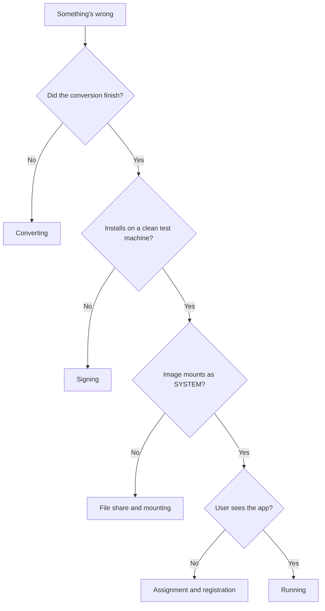
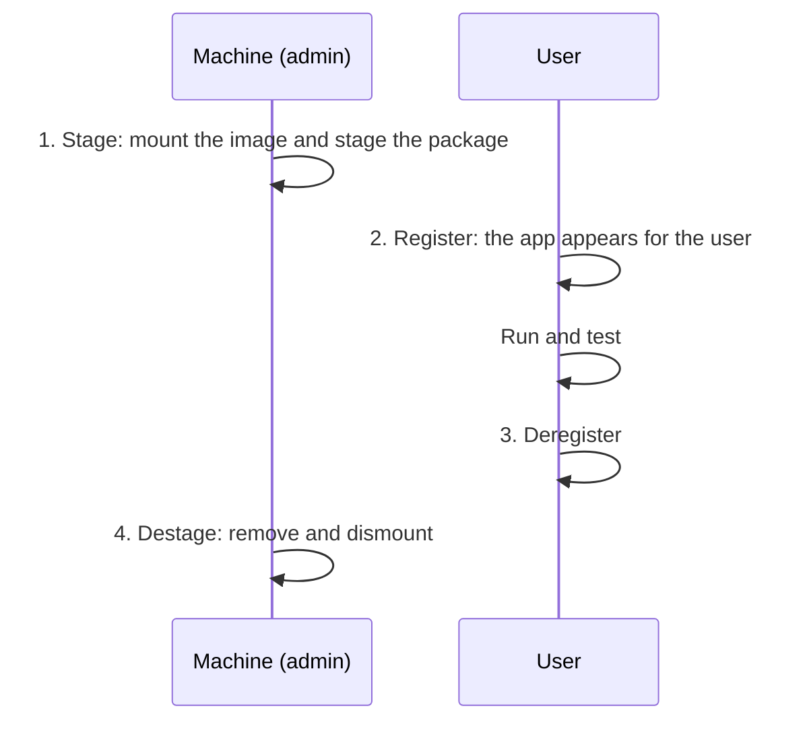

# Troubleshooting App Attach and MSIX

!!! abstract "At a glance"
    - **Four places it can break:** converting, signing, the file share, and the user's session.
    - **Narrow it down first.** If a package installs and runs on a clean test machine, the package is fine, so look at the share or the assignment.
    - **Most signing errors are one of two things:** a publisher that doesn't match the certificate, or a certificate that isn't trusted.
    - **Most runtime errors are writes.** MSIX redirects them, and the Package Support Framework (PSF) fixes apps that expect otherwise.

## Where problems show up

<span class="level l100">Level 100</span>

![Where App Attach problems show up, in four stages. 1, Convert: exit code 259 means the installer started another process and quit, so use its silent or wait option; drivers can't go in MSIX, and the services report shows which services converted. 2, Sign: error 0x8007000B with Event ID 150 means the manifest Publisher doesn't exactly match the certificate subject; error 0x800B0109 means the certificate isn't trusted, so trust the root and intermediate certificates on every host. 3, Store and mount: if an image won't mount, mount it as SYSTEM with PsExec to test the share permissions; Microsoft Entra joined hosts need Azure Files plus Reader and Data Access for both Azure Virtual Desktop service principals. 4, Register and run: if an app can't write to its folder, add the PSF file redirection fixup in the Package Editor; if an update is refused, give the new image a different version number. Test outside App Attach first: stage and register the package on a clean test machine, and if it works there, look at the share or the assignment rather than the package.](../assets/images/app-attach-trouble-map-light.svg#only-light)
![Where App Attach problems show up, in four stages. 1, Convert: exit code 259 means the installer started another process and quit, so use its silent or wait option; drivers can't go in MSIX, and the services report shows which services converted. 2, Sign: error 0x8007000B with Event ID 150 means the manifest Publisher doesn't exactly match the certificate subject; error 0x800B0109 means the certificate isn't trusted, so trust the root and intermediate certificates on every host. 3, Store and mount: if an image won't mount, mount it as SYSTEM with PsExec to test the share permissions; Microsoft Entra joined hosts need Azure Files plus Reader and Data Access for both Azure Virtual Desktop service principals. 4, Register and run: if an app can't write to its folder, add the PSF file redirection fixup in the Package Editor; if an update is refused, give the new image a different version number. Test outside App Attach first: stage and register the package on a clean test machine, and if it works there, look at the share or the assignment rather than the package.](../assets/images/app-attach-trouble-map-dark.svg#only-dark)

## Start here

<span class="level l200">Level 200</span>

Answer each question in turn. The first "no" tells you which table to read.



## Converting

<span class="level l200">Level 200</span>

| Symptom | Likely cause | Fix |
| --- | --- | --- |
| Exit code 259 | *"the installer spawned a thread and did not wait for it to complete"* | Use the installer's own silent or wait option |
| File not found, access denied, or file in use | A file the installer needs is missing or open | Add the file, or close whatever has it open |
| Context menus are missing | A context menu *"is not automatically added"* | Add `desktop4:FileExplorerContextMenus` to the manifest |
| Shortcuts with arguments are missing | They weren't detected | Add `desktop7:Shortcut` to the manifest |
| A service is in the Excluded table | It needs more information, needs a fix, or isn't supported | Fix it in the services report, or keep the app in the image |
| The app needs a driver | MSIX doesn't support Windows drivers | Keep the app in the image, or in a separate host pool |
| An App-V package won't convert | It isn't App-V 5.1 | Convert from the source installer |

Sources: [Known issues](https://learn.microsoft.com/windows/msix/packaging-tool/tool-known-issues), [Services](https://learn.microsoft.com/windows/msix/packaging-tool/convert-an-installer-with-services), [Prepare to package a desktop application](https://learn.microsoft.com/windows/msix/desktop/desktop-to-uwp-prepare), [Create an MSIX package](https://learn.microsoft.com/windows/msix/packaging-tool/create-app-package).

## Signing

<span class="level l200">Level 200</span>

| Symptom | Likely cause | Fix |
| --- | --- | --- |
| `0x8007000B`, with Event ID 150 in the AppxPackagingOM log | The manifest `Publisher` doesn't exactly match the certificate subject, *"including all distinguished name fields in the same order"* | Copy the certificate's subject into the manifest, then sign again |
| `0x800B0109`, certificate not trusted | The certificate chain isn't trusted on the device | Trust the whole chain on every host: an Intune trusted certificate profile for your own CA, or a public CA certificate |
| Signing fails with a SHA-1 certificate | SHA-1 isn't supported for MSIX | Use a SHA-256 certificate |
| Packages stop installing when the certificate expires | They weren't timestamped | Sign with a timestamp |

!!! warning "Not the Trusted Root store"
    Learn's MSIX guide uses **Local Computer > Trusted People** for a test certificate, and says not to import signing certificates into Trusted Root Certification Authorities *"unless the certificate is a root CA"* ([MSIX troubleshooting guide](https://learn.microsoft.com/windows/msix/msix-troubleshooting-guide)). For App Attach, the whole chain must be trusted on the session hosts ([App Attach overview](https://learn.microsoft.com/azure/virtual-desktop/app-attach-overview)). See [Signing certificates, demystified](certificates.md).

Sources: [MSIX troubleshooting guide](https://learn.microsoft.com/windows/msix/msix-troubleshooting-guide), [Best practices](https://learn.microsoft.com/windows/msix/packaging-tool/tool-best-practices).

## File share and mounting

<span class="level l200">Level 200</span>

| Symptom | Likely cause | Fix |
| --- | --- | --- |
| The image won't mount | The session host can't read the share | Test as the host does, below |
| Microsoft Entra joined hosts can't read the share | A role assignment is missing | Use Azure Files, and assign **Reader and Data Access** to the Azure Virtual Desktop and Azure Virtual Desktop ARM Provider service principals |
| AD DS joined hosts can't read the share | Share or NTFS permissions are missing | **Storage File Data SMB Share Reader** as the default share-level permission, plus NTFS read for each session host's computer object |
| Azure NetApp Files with Microsoft Entra joined hosts | Azure NetApp Files *"requires your session hosts to be joined to Active Directory Domain Services"* | Use Azure Files |
| Microsoft Entra Domain Services | Not supported for App Attach | Use Microsoft Entra ID or AD DS |

Source: [App Attach overview](https://learn.microsoft.com/azure/virtual-desktop/app-attach-overview). Keep App Attach packages in their own storage account, as Learn recommends.

**Test as the host does.** Run PowerShell as the system account with PsExec, then mount the image ([Troubleshoot App Attach](https://learn.microsoft.com/troubleshoot/azure/virtual-desktop/troubleshoot-app-attach)):

1. In an administrator PowerShell window, run `PsExec.exe -s -i powershell.exe`.
2. In the new window, `whoami` should return `nt authority\system`.
3. Mount the image, then dismount it:

```powershell
Install-Module CimDiskImage   # if it isn't installed yet
Import-Module CimDiskImage
Mount-CimDiskImage -ImagePath \\fileshare\msix\MyApp.cim -DriveLetter Z:
Get-CimDiskImage | Dismount-CimDiskImage
```

If it mounts, the host has the access it needs. For a VHDX image, use `Mount-DiskImage` and `Dismount-DiskImage` instead.

## Assignment and registration

<span class="level l200">Level 200</span>

| Symptom | Likely cause | Fix |
| --- | --- | --- |
| The user doesn't see the app | One of three conditions isn't met | The app is assigned to the host pool, the user can sign in to that pool, and the app is assigned to the user or their group. For RemoteApp, also add it to a RemoteApp application group |
| Sign-in is slow | **Log on blocking** registration | Use **On-demand**, the recommended default |
| An update is refused | The new image has the same version number | Use a different version number. It can be higher or lower |
| Some users still have the old version | Updates apply at the next sign-in | That's expected. Don't delete the old image until everyone has finished using it |

Source: [App Attach overview](https://learn.microsoft.com/azure/virtual-desktop/app-attach-overview).

## Running

<span class="level l200">Level 200</span>

| Symptom | Likely cause | Fix |
| --- | --- | --- |
| The app can't save settings, and Process Monitor shows "Access Denied" | It writes to its install folder | The PSF file redirection fixup, from the **PSF Fixups** tab in the Package Editor |
| Files the app wrote seem to disappear | MSIX redirects writes to protected paths, by design | Look in `%LocalAppData%\Packages\<PackageFamilyName>\LocalCache\Local\VFS\` |
| Registry values don't persist or aren't shared | Writes to `HKLM\Software` go to a per-package hive | Write per-user settings to `HKCU`, or declare shared entries in the manifest |
| A DLL isn't found, or the app needs a working directory or arguments | The app's launch assumptions | PSF fixups for the working directory and command line arguments |
| The app needs a runtime that isn't there | A framework dependency, such as Visual C++ or .NET, is missing | Declare the framework dependency |

Sources: [PSF overview](https://learn.microsoft.com/windows/msix/psf/package-support-framework-overview), [Automated PSF config generation](https://learn.microsoft.com/windows/msix/psf/psf-integration-with-mpt), [MSIX troubleshooting guide](https://learn.microsoft.com/windows/msix/msix-troubleshooting-guide).

## Test a package outside Azure Virtual Desktop

<span class="level l300">Level 300</span>

The APIs behind App Attach are on Windows 11 Enterprise, Windows 10 Enterprise, Windows Server 2025 and Windows Server 2022, so you can test a package on a single machine with no host pool. There are four phases, in this order ([Test MSIX packages for App Attach](https://learn.microsoft.com/azure/virtual-desktop/app-attach-test-msix-packages)):



- **Stage and destage** are machine-level. **Register and deregister** are user-level.
- The scripts in the article use the CimDiskImage PowerShell module. Learn notes that *"Microsoft Support doesn't support CimDiskImage PowerShell module"*, so report problems with it on its GitHub repository.
- If the package works here, it's sound, and any App Attach fault is in the share, the permissions or the assignment.

## Where the logs are

<span class="level l300">Level 300</span>

| What you're checking | Where to look |
| --- | --- |
| A conversion, successful or not | `%localappdata%\packages\Microsoft.MsixPackagingTool_8wekyb3d8bbwe\LocalState\DiagOutputDir\` ([Known issues](https://learn.microsoft.com/windows/msix/packaging-tool/tool-known-issues)) |
| An install or deployment | Event Viewer: **Applications and Services Logs > Microsoft > Windows > AppxDeployment-Server > Operational** |
| A publisher mismatch | The AppxPackagingOM log, Event ID 150 |
| Access denied at run time | Process Monitor ([PSF overview](https://learn.microsoft.com/windows/msix/psf/package-support-framework-overview)) |

The event log locations are from the [MSIX troubleshooting guide](https://learn.microsoft.com/windows/msix/msix-troubleshooting-guide).

## Under the hood

<span class="level l400">Level 400</span>

- **Every session host mounts the image.** At sign-in, App Attach mounts the disk image or App-V package from the share, then registers the application in the user's session. That's why share permissions are per host, not per user ([App Attach overview](https://learn.microsoft.com/azure/virtual-desktop/app-attach-overview)).
- **Registration is where sign-in time goes.** **Log on blocking** registers every assigned application during sign-in, while **On-demand** waits until the application is launched ([App Attach overview](https://learn.microsoft.com/azure/virtual-desktop/app-attach-overview)).
- **The container is doing its job.** MSIX redirects file writes to protected locations and isolates `HKLM\Software` writes in a per-package hive, so an uninstall is clean. Most "it worked as App-V" surprises come from this, and the PSF exists to bridge it ([MSIX troubleshooting guide](https://learn.microsoft.com/windows/msix/msix-troubleshooting-guide)).
- **The publisher is part of the package identity.** The publisher in the manifest has to match the signing certificate's subject, which is why the certificate subject should be decided before the first conversion, not after ([MSIX troubleshooting guide](https://learn.microsoft.com/windows/msix/msix-troubleshooting-guide)).

## Microsoft Learn

- [Troubleshoot App Attach in Azure Virtual Desktop](https://learn.microsoft.com/troubleshoot/azure/virtual-desktop/troubleshoot-app-attach)
- [Test MSIX packages for App Attach](https://learn.microsoft.com/azure/virtual-desktop/app-attach-test-msix-packages)
- [App Attach in Azure Virtual Desktop](https://learn.microsoft.com/azure/virtual-desktop/app-attach-overview)
- [MSIX troubleshooting guide](https://learn.microsoft.com/windows/msix/msix-troubleshooting-guide)
- [MSIX Packaging Tool known issues](https://learn.microsoft.com/windows/msix/packaging-tool/tool-known-issues)
- [Best practices for the MSIX Packaging Tool](https://learn.microsoft.com/windows/msix/packaging-tool/tool-best-practices)
- [Package Support Framework overview](https://learn.microsoft.com/windows/msix/psf/package-support-framework-overview)
- [Automated PSF config generation](https://learn.microsoft.com/windows/msix/psf/psf-integration-with-mpt)
- [Troubleshoot runtime issues in an MSIX container](https://learn.microsoft.com/windows/msix/manage/troubleshoot-msix-container)

---

Part of [Applications with App Attach](index.md).
